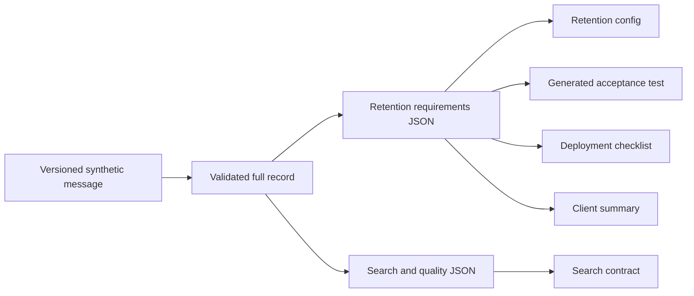

# Client requirement change with fac

A small, fully synthetic engineering experiment for Professor Michael Izbicki. A knowledge-assistant customer changes conversation retention from **30 days to 7 days**. A display-name punctuation edit is a separate negative control. No LLM, API key, database, authentication, or external service is needed to run the experiment.

This example uses [Mike Izbicki's fac](https://github.com/mikeizbicki/fac) at commit [`2a099e6e97db390fa578a33edf9f66d61aec5818`](https://github.com/mikeizbicki/fac/tree/2a099e6e97db390fa578a33edf9f66d61aec5818), the compatibility reference requested for the [tutorial](https://github.com/HillZhang2004/fac-llm-workflow-lab). Credit for the build system belongs to its upstream author. The example references that unmodified commit through a Git submodule and contributes its own fixtures, configurations, tests, and measurements.

## What to read first

1. [`expected-impact.json`](expected-impact.json): the business oracle, written before execution.
2. [`fac.yaml`](fac.yaml): the actual explicit-dependency graph.
3. [`workflow.py`](workflow.py): deterministic parsing, semantic projections, and small templates.
4. [`acceptance.py`](acceptance.py): independent business checks, including a literal seven-day deletion oracle.
5. [`results/impact-report.md`](results/impact-report.md): measured results with limitations.
6. [`DEMO.md`](DEMO.md): a three-minute walkthrough.

## Small business example

The synthetic message defines three named requirements:

- **REQ-RETENTION:** retain conversation history for the agreed number of days; delete at and beyond that boundary.
- **REQ-SEARCH:** knowledge-base search returns the top two documents.
- **REQ-QUALITY:** “password reset” retrieves `KB-RESET` first; responses cite that document and contain at most 40 words.

V2 changes only retention semantics. Its additional nonmaterial edit changes `Cedar Demo` to `Cedar Demo.`. A separate branch starts from V1 and changes only that punctuation, so the control is not confounded by undoing the seven-day change.

Five deliverables are generated: a JSON retention configuration, an executable retention acceptance test, a deployment checklist, a client-facing change summary, and an unrelated JSON search/quality contract. The summary explicitly compares the current agreement with the immutable V1 message copied to `input/baseline-message.json`; this historical input is also declared in fac. `policy.py` implements a tiny in-memory retention filter and lexical search/answer function so that acceptance tests exercise behavior.

## Responsibilities

**fac provides** target resolution, dependency ordering, command execution, stale/reuse decisions, prompt hashing, native `.buildlog` events, and `.facjson` context metadata. Its automatic Git commits are disabled for this experiment, but each run has a new local Git repository because fac requires one. The runner enables the existing `--debug.halt_on_error` option because this revision can otherwise return exit code zero after a command failure.

**This example provides** a deliberately narrow synthetic-message parser, strict JSON Schema validation, two canonical requirement projections, deterministic artifact templates, business assertions, and a fixed experiment/measurement protocol. `experiment.py` submits the same five targets to the real fac CLI at each stage. It never chooses which targets to rebuild and never replaces the scheduler.



Requirement-level reuse is implemented through ordinary files, not native fac JSON-field dependencies. A changed full record causes both projection commands to run. If a projection's content stays identical, fac's included-content hash can preserve its downstream deliverables. Counts of projection work are reported separately from the five deliverables.

## Set up and run

Prerequisites: Python 3.12 and Git. Initial submodule checkout and dependency installation require network access; experiment runs and tests then work offline. The supplied lock records the verified Python 3.12.12 / pytest 9.1.1 environment. A clean package installation has not been independently tested.

```bash
# From the repository root, initialize only this submodule (not recursively).
git submodule update --init -- examples/client-requirement-change/vendor/fac
cd examples/client-requirement-change
python3.12 -m venv .venv
.venv/bin/python -m pip install -r requirements.lock
.venv/bin/python -B experiment.py --output results-local
.venv/bin/python -B -m pytest -q
```

If the required packages are already installed, invoke that Python interpreter directly instead of creating `.venv`. `results/` already contains the original measured run. Choose a fresh output directory, such as `results-local` or `results-repeat`, to preserve the original evidence. Original exact commands and machine paths remain in the recorded measurements.

The pytest suite creates its own fresh experiment in a temporary directory. The intentionally failed checklist acceptance check is an **expected experimental outcome**; the outer test suite must pass by verifying that failure and the unsafe reuse that caused it.

The submodule places the pinned upstream source under `vendor/fac/` without copying or modifying its implementation in this repository. `vendor/source-manifest.json` records the original commit and file hashes; the runner verifies all 76 tracked source files before execution. Upstream's own nested submodules are not required and should not be initialized recursively. `requirements.lock` captures 88 installed packages, including upstream dependencies beyond the narrow features this example uses. No workflow scheduler is developed here.

## Compare the three configurations

| Mode | Inputs recorded for each deliverable | Controlled point |
|---|---|---|
| Explicit | Supporting semantic requirement file plus renderer/mode files | Fine-grained, declared dependencies |
| Conservative | Explicit inputs plus full parsed record and raw client message | Generator actually reads the complete supplied context |
| Missing | Explicit setup, except checklist incorrectly tracks search while reading retention from the full record | One deliberately omitted direct retention edge |

The missing checklist has a transitive ordering relationship through the search projection to the record. It does **not** record retention as content that affects its generation. After V2, that search projection is byte-identical, so fac reuses the checklist. This is the controlled incomplete-dependency case; it is not a defect inserted into fac.

The complete-context baseline is conservative only with respect to the files actually supplied to generation. It is not an operating-system file-read tracer. All modes track `workflow.py`, and configuration variants are chosen once before the initial build. The experiment does not mutate renderer code, runtimes, or configuration mid-run.

## Measured results

The saved run produced the following deliverable counts. FN means a required regeneration was missed; FP means an unnecessary regeneration occurred relative to the business oracle.

| Mode | V2 rebuilt | V2 FN | V2 FP | Punctuation-only rebuilt |
|---|---:|---:|---:|---:|
| Explicit | 4 | 0 | 0 | 0 |
| Conservative | 5 | 0 | 1 | 5 |
| Missing | 3 | 1 | 0 | 0 |

All three unchanged reruns generated **zero targets**, including parser/projection targets. Explicit V2 passed all six acceptance checks and preserved the search deliverable's hash and mtime. Missing V2 passed five checks and failed the independent checklist check: its checklist still said 30 days while configuration and executable retention tests said 7. Conservative V2's extra search generation produced identical bytes; the native build log and changed mtime still show the work occurred. Five punctuation-only generations are extra potential review candidates; no human review time was measured.

The independent expected table was not changed after observing results. Its SHA256 is frozen in `results/expected-impact.frozen.json` and `results/summary.json`. Final outer verification: **25 passed in 69.74 seconds**. Focused compatibility verification: **6 passed in 8.59 seconds**. `verification.log`/`.xml` and `compatibility.log`/`.xml` preserve those actual results. A direct fac rerun against the completed V2 project also returned zero with **zero additional native build events**, recorded in `direct-fac-rerun.log`.

After preparing the GitHub layout with the pinned submodule, the full suite was rerun: **25 passed in 68.40 seconds**. `publication-verification.log` and `.xml` record that separate verification.

## Inspect fac directly

After running the experiment into `results-local`, its explicit V2 working directory is an ordinary fac project. From this example directory, use:

```bash
export PYTHON="$PWD/.venv/bin/python"
export PYTHONPATH="$PWD/vendor/fac"
cd results-local/explicit/material/work
"$PYTHON" -B -m fac --no-auto_commit --debug.halt_on_error --max_workers 1 artifacts/retention-config.json artifacts/test_retention.py artifacts/deployment-checklist.md artifacts/client-summary.md artifacts/search-contract.json
```

That unchanged rerun should build nothing. To observe a change, copy the desired versioned input to `input/client-message.json` and invoke the same command. Use a fresh experiment output when you want to preserve the supplied evidence.

## Evidence and provenance

```text
inputs/                         V1, V2, punctuation-only synthetic messages
expected-impact.json            independent oracle fixed before execution
fac.yaml                        explicit mode; two other mode configurations alongside
workflow.py / policy.py         transformations and tiny executable behavior
requirements.schema.json        strict requirements-record structure
acceptance.py / tests/          independent checks and fresh-run integration tests
vendor/                         pinned fac submodule plus source-hash manifest
results/
  summary.json                  commands, counts, failures, source hashes
  impact-report.md              confirmed results and human-review limits
  MODE/material/work/           actual V2 fac project and native metadata
  MODE/material/evidence/       initial, unchanged, and V2 snapshots
  MODE/cosmetic/                 separate V1 -> punctuation-only branch
verification.log / .xml         outer test results
compatibility.log / .xml        focused upstream-limit probe results
development/initial-failure.*   preserved failed first verification
DEMO.md                         three-minute presentation script
LIMITATIONS.md                  compatibility probes and follow-up questions
```

Each artifact identifies supporting requirement IDs and canonical value hashes. The full requirements record links to the raw synthetic message and its SHA256. Stage snapshots retain the source, requirements, artifacts, native build metadata, file hashes/mtimes, and independent acceptance results. The harness hashes finished files independently: fac's native content hashes can precede final formatting and differ from the delivered JSON bytes. For a reused artifact, the prior generation's prompt snapshot remains available; semantic values are compared rather than relabeling the old generation as new.

The first verification run reported **22 passed, 2 failed** because it assumed failed fac commands would return a nonzero CLI exit code. `development/initial-failure.log` and `.xml` preserve that result. Enabling fac's existing halt-on-error option fixes the harness's error handling; a separate probe now documents the default behavior. The expected-impact table was unchanged.

Saved evidence excludes generated Git internals and temporary caches. After cloning this repository, initialize the pinned submodule and run `experiment.py` into a fresh output directory before using the direct fac command. Downloading a GitHub source ZIP does not populate submodules.

This is an exploratory prototype for studying dependency completeness and selective reuse. It establishes a reproducible small example, not enterprise readiness, a novel algorithm, or a completed thesis contribution.
